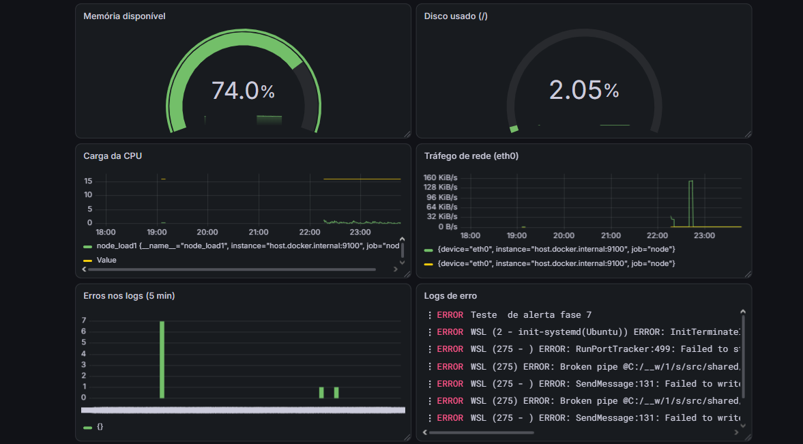
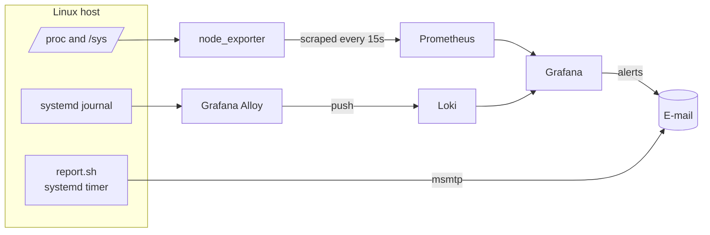
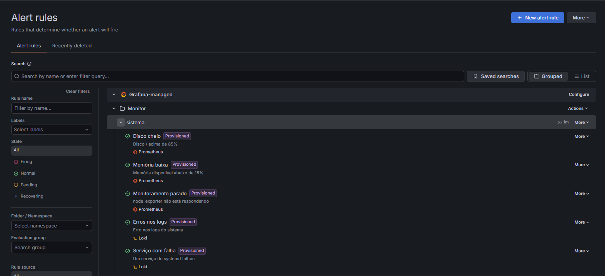
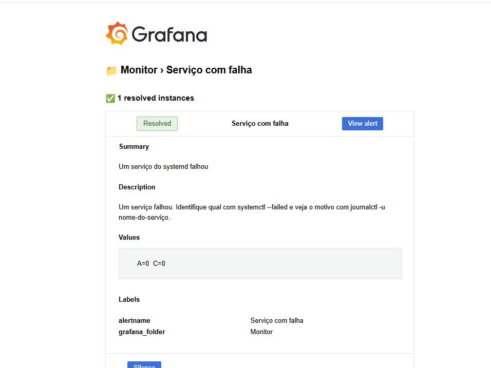
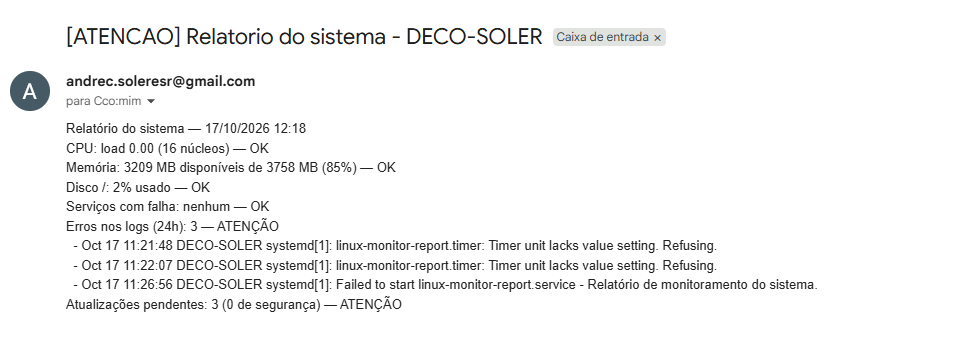
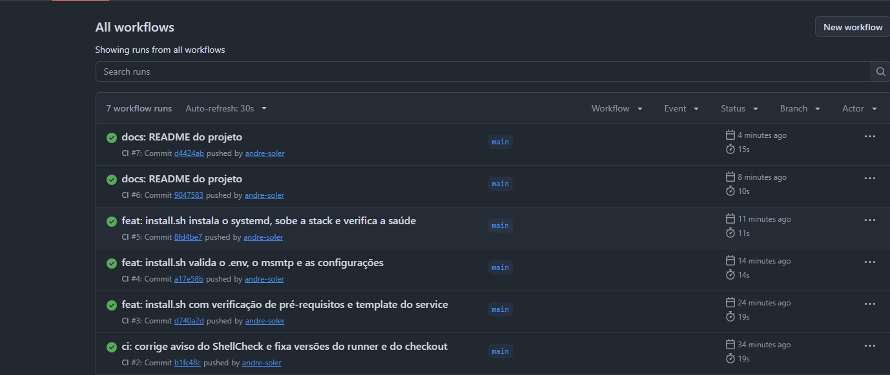

# Linux Monitoring Stack

[](https://github.com/andre-soler/linux-monitoring-stack/actions/workflows/ci.yml)

🇧🇷 [Leia em português](README.pt-BR.md)

Full observability stack for a Linux machine: metrics, logs, dashboards, alerts and a daily health report by e-mail. Everything is defined as code and installed with a single script.

Built step by step as a hands-on DevOps project, starting from manual Linux diagnostics and ending with a fully provisioned monitoring stack.



## Features

- **Daily health report** — a Bash script checks CPU, memory, disk, failed services, log errors and pending updates, runs daily via a systemd timer and is sent by e-mail.
- **Metrics** — node_exporter + Prometheus, with 15-day retention.
- **Logs** — Grafana Alloy collects the systemd journal and ships it to Loki, with 15-day retention.
- **Dashboard** — metrics and logs side by side in a single Grafana dashboard.
- **Alerts** — five Grafana alert rules with e-mail notifications, grouping and repeat control.
- **Everything as code** — data sources, dashboard, contact point, notification policy and alert rules are provisioned from files. A fresh Grafana comes up identical.
- **CI** — GitHub Actions runs ShellCheck and validates the Compose and Prometheus configs on every push.
- **One-command install** — `install.sh` checks prerequisites, validates configs, installs the systemd units, starts the stack and verifies each service's health.

## Architecture



| Component | Role |
| --- | --- |
| **node_exporter** | Reads host metrics (CPU, memory, disk, network) |
| **Prometheus** | Scrapes and stores metrics |
| **Grafana Alloy** | Reads the systemd journal and ships logs |
| **Loki** | Stores logs |
| **Grafana** | Dashboards and alerting over both data sources |
| **report.sh** | Daily report, scheduled by systemd and sent via msmtp |

## Tech stack

| Tool | Version |
| --- | --- |
| Prometheus | 3.15.0 |
| node_exporter | 1.12.1 |
| Grafana | 13.2.4 |
| Loki | 3.7.8 |
| Grafana Alloy | pinned in `docker-compose.yml` |
| Docker Compose, systemd, Bash, msmtp, GitHub Actions | — |

All image versions are pinned to keep the stack reproducible.

## Repository structure

```
.
├── install.sh                  # One-command installer
├── docker-compose.yml          # Monitoring stack
├── .env.example                # Required environment variables
├── scripts/
│   ├── report.sh               # Health report
│   └── send-report.sh          # Generates and e-mails the report
├── config/
│   ├── report.conf             # Report thresholds
│   └── ignore-patterns.txt     # Known log noise to ignore
├── systemd/                    # Service template and timer
├── prometheus/                 # Prometheus config
├── loki/                       # Loki config (15-day retention)
├── alloy/                      # Log collection pipeline
├── grafana/
│   ├── provisioning/           # Data sources, dashboards, alerting
│   └── dashboards/             # Dashboard JSON
└── docs/                       # Phase notes and screenshots
```

## Installation

### Prerequisites

- Linux with systemd (tested on Ubuntu under WSL2)
- Docker Engine with the Compose plugin
- `msmtp` and `curl`

### 1. Configure e-mail sending (msmtp)

The daily report is sent with `msmtp`. Create `~/.msmtprc` with your SMTP account (for Gmail, use an [app password](https://myaccount.google.com/apppasswords)):

```
defaults
auth on
tls on
tls_trust_file /etc/ssl/certs/ca-certificates.crt

account gmail
host smtp.gmail.com
port 587
from you@gmail.com
user you@gmail.com
password YOUR_APP_PASSWORD

account default : gmail
```

Then protect it, since it contains a password:

```bash
chmod 600 ~/.msmtprc
```

### 2. Clone and install

```bash
git clone https://github.com/andre-soler/linux-monitoring-stack.git
cd linux-monitoring-stack
./install.sh
```

On the first run, `install.sh` creates `.env` from `.env.example` and stops. Fill in the values and run it again.

### 3. Access

- **Grafana:** http://localhost:3000 (user `admin`, password from `.env`)
- **Prometheus:** http://localhost:9090

All ports are bound to `127.0.0.1` only.

## Alerts

| Alert | Source | Condition | Pending |
| --- | --- | --- | --- |
| Disk full | Prometheus | `/` usage above 85% | 5m |
| Low memory | Prometheus | available memory below 15% | 5m |
| Monitoring down | Prometheus | node_exporter not responding | 2m |
| Log errors | Loki | real errors in the journal, excluding known noise | 0s |
| Service failed | Loki | a systemd unit failed | 0s |

Every alert was tested by triggering the underlying problem on purpose (e.g. `logger -p user.err`, a failing `systemd-run` unit, stopping node_exporter).

## Technical decisions

- **Grafana Alerting instead of Alertmanager** — a single place to alert on both Prometheus and Loki, with no extra container.
- **Collect the journal only, not `/var/log`** — on Ubuntu, `syslog`, `kern.log` and `auth.log` are copies of the journal written by rsyslog. Collecting both would duplicate every log line in Loki.
- **Fighting alert fatigue** — known noise is filtered out in the report, the log panels and the alert rules; alerts use pending periods and grouping; the "no data" handling is enabled only on the *Monitoring down* rule, so a single outage doesn't fire one alert per symptom.
- **Least privilege** — the report runs as a regular user (`User=` in the service, `adm` group to read logs); host mounts are read-only; secrets live outside the repository with `600` permissions; each tool has its own SMTP app password.
- **Configuration as code** — fixed data source UIDs (`prometheus`, `loki`) keep the dashboard and alert rules portable. The dashboard is provisioned with `allowUiUpdates: false`, so the repository is the single source of truth.
- **Disk usage matching `df`** — the naive PromQL formula (`avail / size`) reported ~7% while `df` reported ~2%. The difference is the 5% of ext4 blocks reserved for root. The dashboard and alert use `used / (used + avail)`, the same formula as `df`.
- **Aligned retention** — Prometheus and Loki both keep 15 days, so metrics and logs always cover the same time window.

## Notes on WSL2

This project was developed on Ubuntu under WSL2, which has some quirks worth documenting:

- **Memory** is limited by WSL, not by the host's total RAM.
- **The root disk** reports a 1 TB virtual size; real free space is the Windows drive's.
- **`/dev/loop0` at 100%** is a read-only image from Docker Desktop — not a problem, and excluded from monitoring.
- **WSL boot and shutdown** produce known kernel and relay errors, listed in `config/ignore-patterns.txt`.
- **Mount propagation:** the `rslave` option recommended for node_exporter fails on WSL, because `/` is not a shared mount.
- **Projects should live in the Linux filesystem (`~`)**, not in `/mnt/c`, to avoid permission and line-ending problems.
- **WSL only runs while it is open.** On a real server the stack runs 24/7; on WSL, monitoring pauses when Windows sleeps or shuts down (visible as gaps in the graphs). The timer uses `Persistent=true`, so a missed daily report runs as soon as WSL starts.

## Screenshots

| Alert rules | Alert e-mail |
| --- | --- |
|  |  |

| Daily report | CI |
| --- | --- |
|  |  |

## Next steps

- Deploy the stack to
